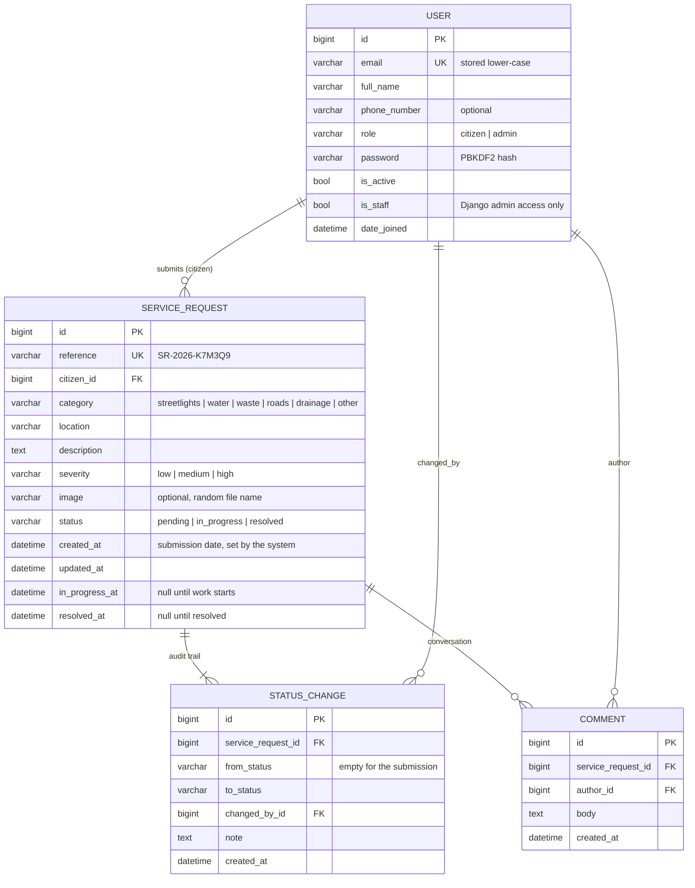

# Database design

A relational schema managed entirely by Django migrations. SQLite is the zero-setup default; PostgreSQL is supported by
setting `DATABASE_URL` (the full backend test suite passes on both, PostgreSQL 18 included).

## Entity-relationship diagram



The standard Django tables (sessions, permissions, groups, admin log) are also present; `accounts_user` has the usual
`groups` / `user_permissions` link tables from `PermissionsMixin`.

## Tables

### `accounts_user`
One table for citizens and administrators. `role` is the **single source of truth for application authorisation**.
It can only be set by an operator (`createsuperuser`, the Django admin, a management command): the public
registration serializer has no `role` field, so anything a client sends for it is ignored. Emails are stored lower-cased
and looked up case-insensitively.

### `service_requests_servicerequest`
A citizen's report.

| Column | Notes |
| --- | --- |
| `reference` | Public case number `SR-<year>-<6 chars>`; alphabet omits `0 O 1 I L` so it can be read over the phone. Unique. Also the URL identifier, so internal ids are never exposed or enumerable. |
| `citizen_id` | `ON DELETE PROTECT` — the public record of a report can't vanish because an account was deleted. |
| `category`, `severity`, `status` | `CharField` + `choices` (validated by the API; vocabulary in `apps/service_requests/domain.py`). |
| `created_at` | The **submission date**, set by the database layer (`auto_now_add`); clients cannot supply it. |
| `in_progress_at`, `resolved_at` | Lifecycle timestamps, set only by the status-change service. |
| `image` | Relative path under `MEDIA_ROOT`, always `service_requests/YYYY/MM/<uuid>.<ext>` — the client's file name is discarded. |

**Constraint `sr_status_matches_timestamps`** (a database `CHECK`) makes status and timestamps impossible to contradict,
whichever code path writes them:

```
pending      → in_progress_at IS NULL     AND resolved_at IS NULL
in_progress  → in_progress_at IS NOT NULL AND resolved_at IS NULL
resolved     → resolved_at IS NOT NULL
```

**Indexes**

| Index | Serves |
| --- | --- |
| `reference` (unique) | detail lookups |
| `sr_citizen_created_idx (citizen_id, created_at DESC)` | "my requests", newest first |
| `sr_status_category_idx (status, category)` | dashboard filters and analytics |
| single-column indexes on `status`, `category`, `citizen_id` | filters / joins |

### `service_requests_statuschange` — the audit trail
One row per lifecycle event, **append-only** (the Django admin shows it read-only with no add/change/delete). The first
row of every request is the submission (`from_status = ''`, `to_status = 'pending'`, `changed_by` = the citizen); each
transition adds a row with the administrator, the note and the time. `changed_by` is `PROTECT`, so an administrator who
has made changes can be deactivated but not deleted. Failed transition attempts never write a row.

### `service_requests_comment`
Messages between the citizen and administrators on a request. Cascade-deleted with its request.

## Relationships and integrity

- Every foreign key has an explicit `on_delete`: `CASCADE` for children of a request (audit rows, comments), `PROTECT`
  for people (you cannot delete a user who has requests, history or comments).
- Status changes happen inside a transaction that **locks the request row** (`SELECT … FOR UPDATE`) and re-reads its
  status before validating the transition, so two administrators acting at once cannot both apply the same step
  (verified by a two-thread test on PostgreSQL; SQLite serialises writes anyway).

## Migrations

One initial migration per app, generated from the models:

```
backend/apps/accounts/migrations/0001_initial.py
backend/apps/service_requests/migrations/0001_initial.py
```

```bash
python manage.py migrate               # apply
python manage.py showmigrations        # status
python manage.py makemigrations --check --dry-run   # CI-style check that models and migrations agree
python manage.py sqlmigrate service_requests 0001   # show the SQL
```

## What analytics read

Nothing is stored for analytics. `GET /api/analytics/summary/` runs aggregate queries (`COUNT … FILTER`, `AVG`,
`GROUP BY`) over `service_requests_servicerequest` on every call, scoped to the caller, so figures can never drift from the
records. Daily series are bucketed in the project time zone (`TIME_ZONE`, default `Africa/Nairobi`); timestamps are stored
in UTC.

## Backups and data protection

SQLite: copy `backend/db.sqlite3` (and `backend/media/`) while the app is stopped. PostgreSQL: `pg_dump`. Uploaded photos
are personal data (and may show people or homes): treat `MEDIA_ROOT` like the database. The pipeline already strips
EXIF/GPS metadata before storing images.
